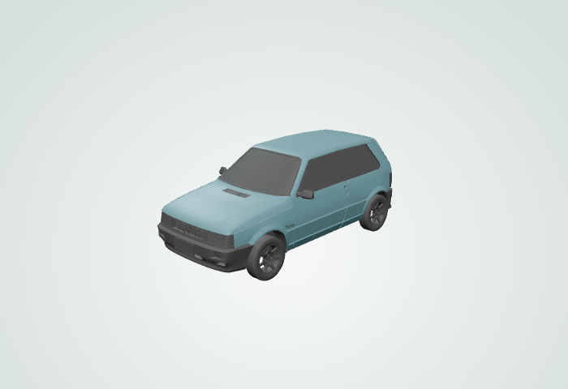
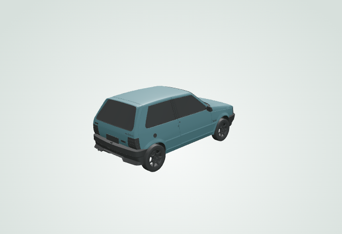
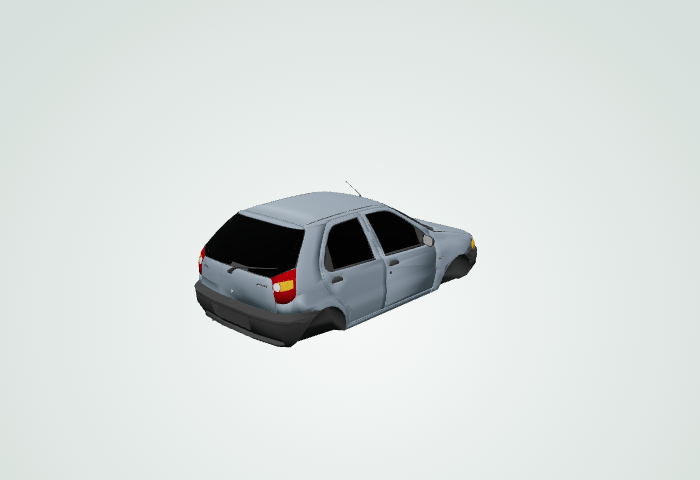
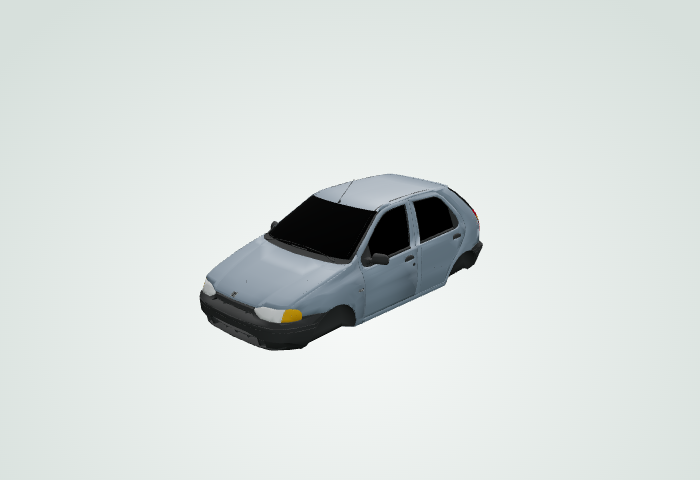
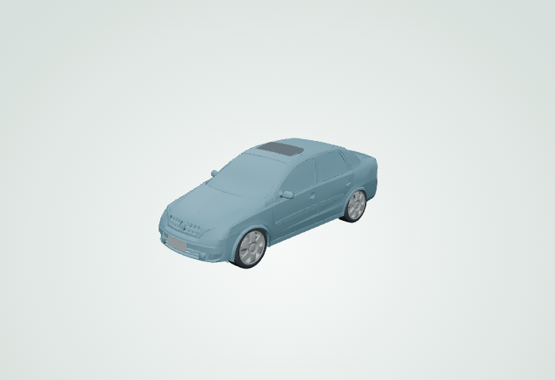
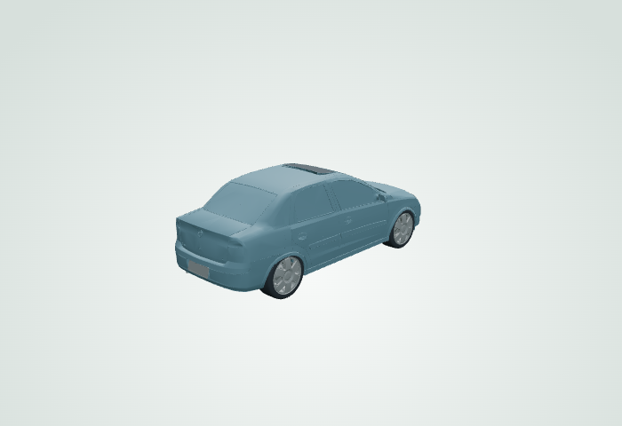
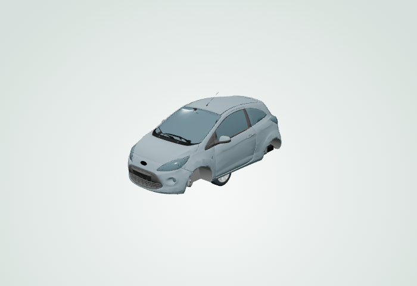
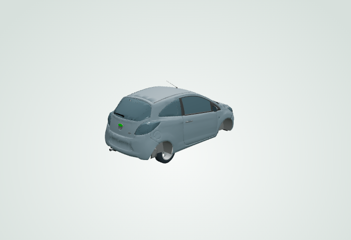
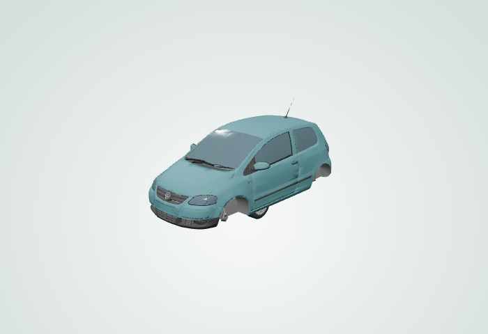
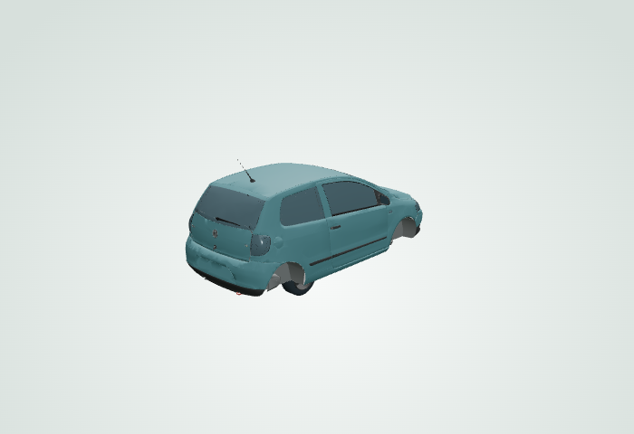

# Miniaturas 3D para revisão visual

**Geradas a partir de GLB reais. Não são miniaturas aprovadas.**

Resultado: 5 / 5 modelos; 0 falhas.

## 2. Fiat Uno
Fonte: fiat uno - Turbo ie 1995 · licença CC Attribution · subishi
Status: GERADO_PENDENTE_REVISAO · revisão humana pendente

## 3. Fiat Palio
Fonte: Fiat Palio 1997 · licença CC Attribution · Fall0X
Status: GERADO_PENDENTE_REVISAO · revisão humana pendente

## 5. Chevrolet Corsa
Fonte: Chevrolet Corsa Sedan 2010 FidwixGamer · licença CC Attribution · FidwixGamer
Status: GERADO_PENDENTE_REVISAO · revisão humana pendente

## 10. Ford Ka
Fonte: Ford Ka MK2 2008-2016 · licença CC Attribution · Merc_TV
Status: GERADO_PENDENTE_REVISAO · revisão humana pendente

## 12. Volkswagen Fox
Fonte: Volkswagen Fox 3-Door 2003-2021 · licença CC Attribution · Merc_TV
Status: GERADO_PENDENTE_REVISAO · revisão humana pendente

