# Miniaturas 3D para revisão visual

**Geradas a partir de GLB reais. Não são miniaturas aprovadas.**

Resultado: 12 / 12 modelos; 0 falhas.

## 2. Fiat Uno
Fonte: fiat uno - Turbo ie 1995 · licença CC Attribution · subishi
Status: GERADO_PENDENTE_REVISAO · revisão humana pendente
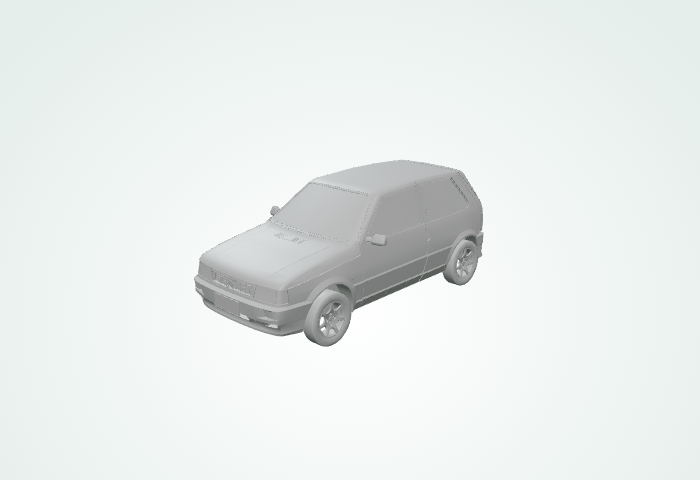
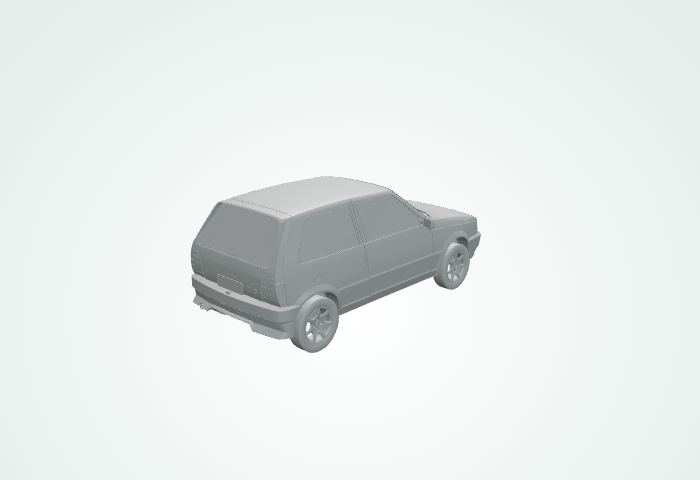

## 3. Fiat Palio
Fonte: Fiat Palio 1997 · licença CC Attribution · Fall0X
Status: GERADO_PENDENTE_REVISAO · revisão humana pendente
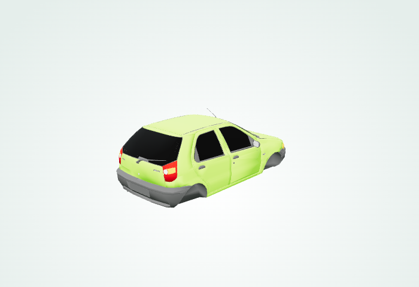
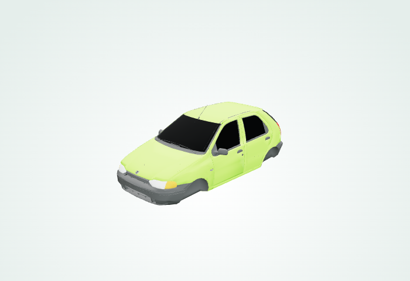

## 4. Fiat Strada
Fonte: Fiat Strada - #LowPolyCarChallenge · licença CC Attribution · Philipp Busse
Status: GERADO_PENDENTE_REVISAO · revisão humana pendente
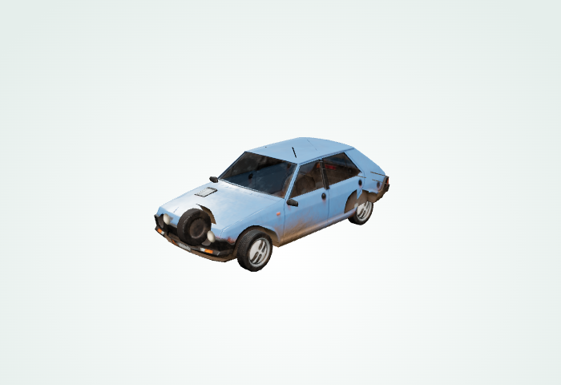
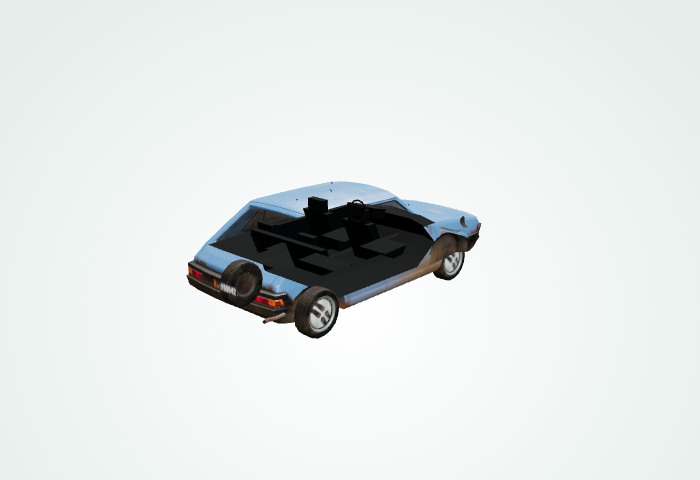

## 5. Chevrolet Corsa
Fonte: Chevrolet Corsa Sedan 2010 FidwixGamer · licença CC Attribution · FidwixGamer
Status: GERADO_PENDENTE_REVISAO · revisão humana pendente
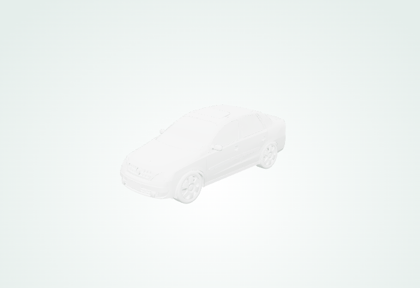
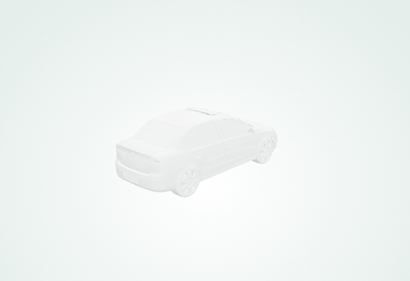

## 6. Volkswagen Fusca
Fonte: volkswagen beetle "The Bug" · licença CC Attribution · DRIVER-FIRE
Status: GERADO_PENDENTE_REVISAO · revisão humana pendente
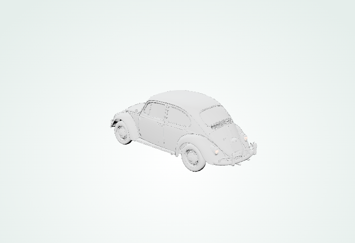
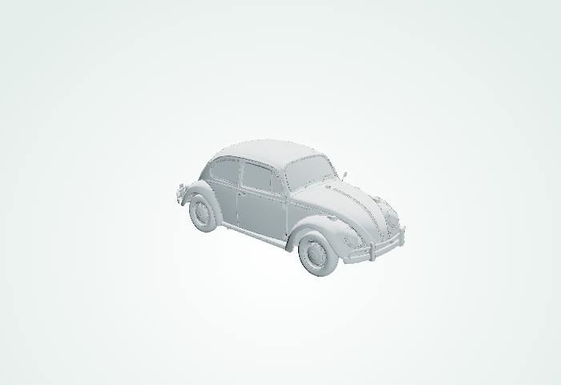

## 7. Ford Fiesta
Fonte: Ford Fiesta Mk5 · licença CC Attribution · 🇷🇴シRuletăシ🇷🇴
Status: GERADO_PENDENTE_REVISAO · revisão humana pendente
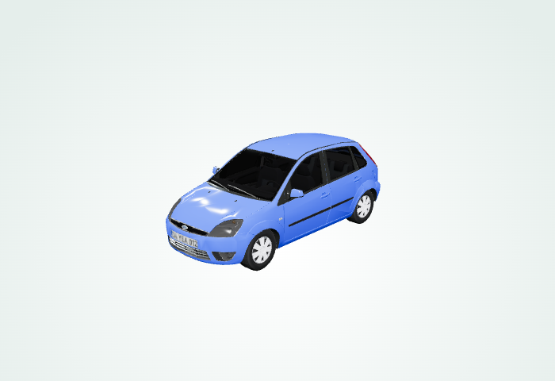
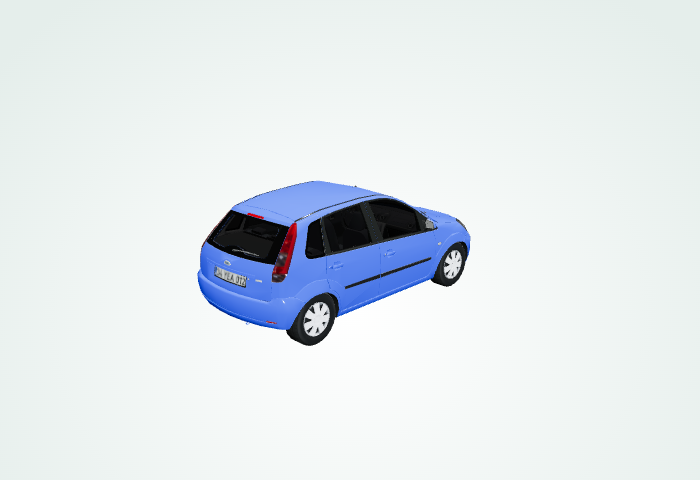

## 8. Chevrolet Onix
Fonte: chevrolet onix · licença CC Attribution · uzb_rx7
Status: GERADO_PENDENTE_REVISAO · revisão humana pendente
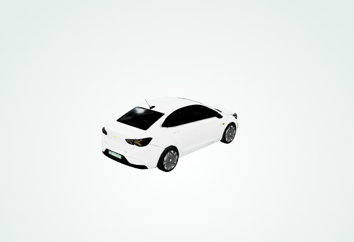
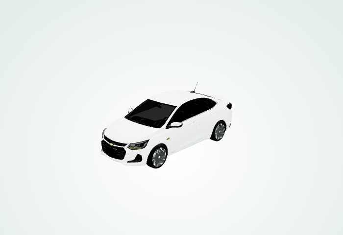

## 9. Chevrolet Celta
Fonte: low poly celta · licença CC Attribution · RATODDY
Status: GERADO_PENDENTE_REVISAO · revisão humana pendente
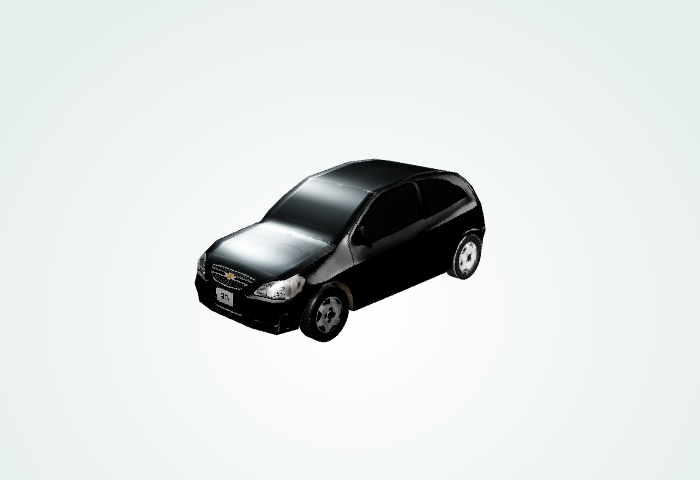
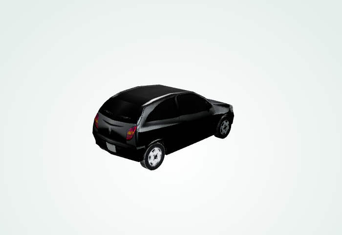

## 10. Ford Ka
Fonte: Ford Ka MK2 2008-2016 · licença CC Attribution · Merc_TV
Status: GERADO_PENDENTE_REVISAO · revisão humana pendente
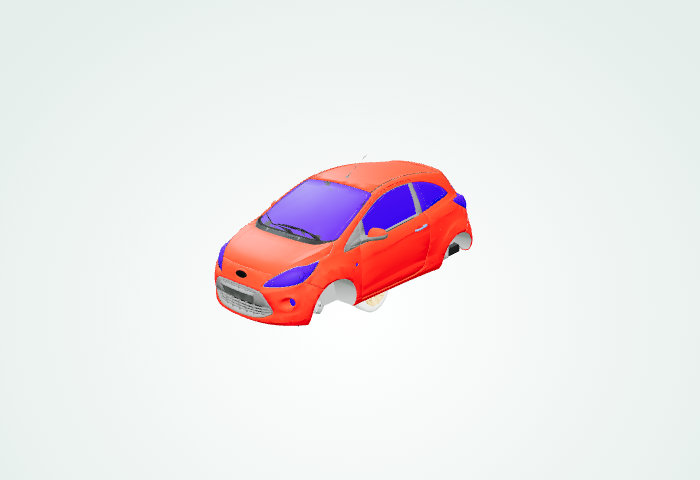
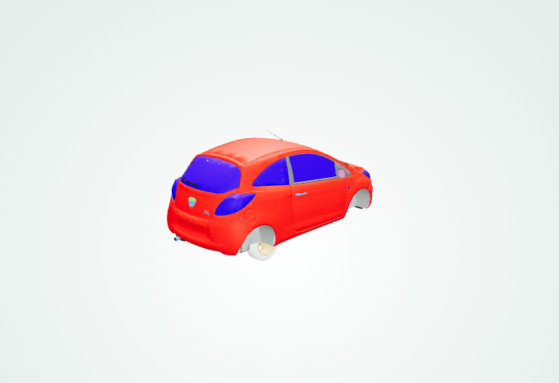

## 11. Volkswagen Saveiro
Fonte: Volkswagen Saveiro Cross · licença CC Attribution · bimboit34
Status: GERADO_PENDENTE_REVISAO · revisão humana pendente
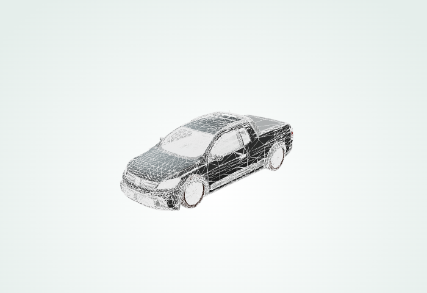
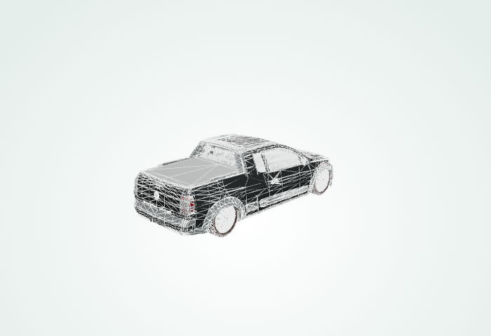

## 12. Volkswagen Fox
Fonte: Volkswagen Fox 3-Door 2003-2021 · licença CC Attribution · Merc_TV
Status: GERADO_PENDENTE_REVISAO · revisão humana pendente
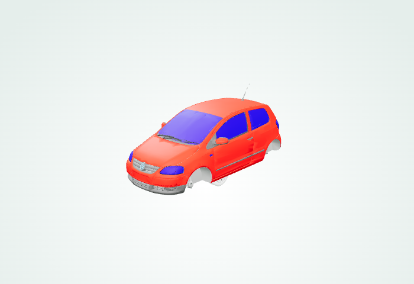
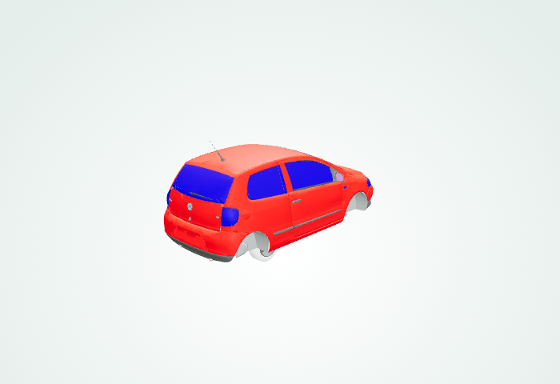

## 14. Volkswagen Voyage
Fonte: Voyage GL 1.8 · licença CC Attribution · lael.eugenio
Status: GERADO_PENDENTE_REVISAO · revisão humana pendente
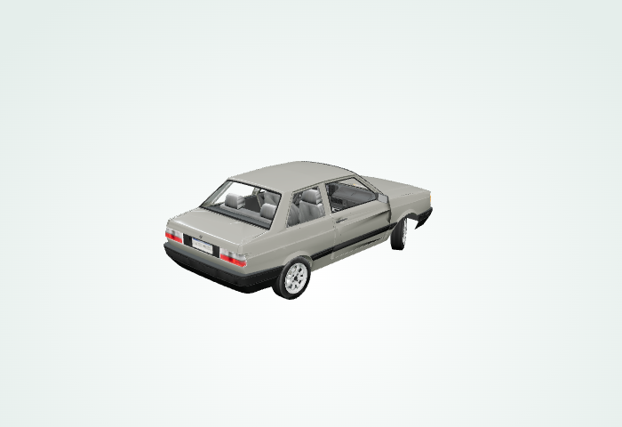
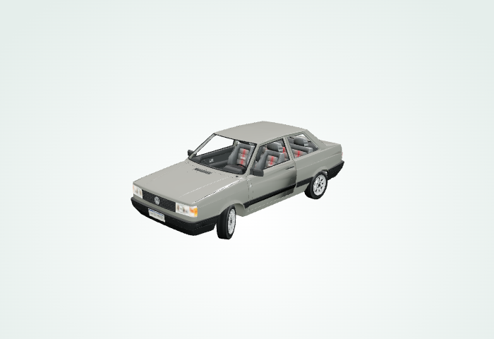
